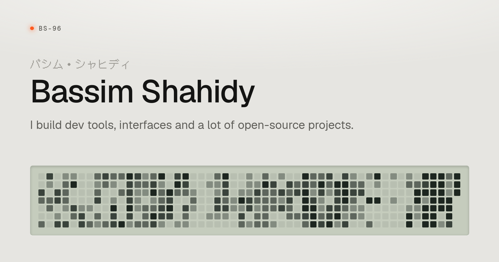

<a href="https://bassim.im">
  <picture>
    <source media="(prefers-color-scheme: dark)" srcset=".github/portfolio-black.png">
    
  </picture>
</a>

[**bassim.im**](https://bassim.im)

My personal site: projects, writing and a year of GitHub activity. Inspired by Japanese electronics from the 1990s, with black and silver finishes, lit contribution displays and a link card that moves between profiles.

Built with Astro 7, TypeScript and CSS. Static HTML, no UI framework. GitHub activity comes from a committed snapshot; npm versions and download counts are fetched at build time.

## Run locally

Use [Bun](https://bun.sh) and Node.js 22.22 or newer.

```sh
bun install --frozen-lockfile
bun dev
```

`bun run check` runs Astro's type checks, Oxlint and the formatter. `bun run build` produces the static site in `dist/`; `bun run preview` serves it locally.

## What's where

| Path | Content |
| --- | --- |
| `src/data/projects.ts` | Projects, their order and links |
| `src/data/activity.json` | GitHub contribution calendar, project history and stars |
| `src/content/posts/` | Markdown posts and YAML links to writing elsewhere |
| `src/components/` | Activity displays, project rows and the profile card |
| `src/styles/global.css` | Shared styles and both finishes |
| `og/` | Source artwork for the share card, README headers and touch icon |

The README headers are rendered from `og/og.html` in both finishes. The share card uses the same styles and contribution snapshot as the site.

## Refresh and deploy

`bun run sync` refreshes the GitHub snapshot with an authenticated [GitHub CLI](https://cli.github.com). It needs access to the public repositories listed in `src/data/projects.ts`.

`bun run deploy` runs `scripts/deploy.sh`: it takes a clean copy of committed `main`, installs locked dependencies, refreshes and commits the activity data, fast-forwards `main`, pushes it to GitHub, builds, and deploys to the Vercel project `portfolio`. Commits use the local Git signing configuration. The daily `portfolio-sync` timer runs the same script at 5am.

The production address is **https://bassim.im**. Canonical links, Open Graph URLs and the sitemap use Vercel's `VERCEL_PROJECT_PRODUCTION_URL`, with `bassim.im` as the local fallback.
