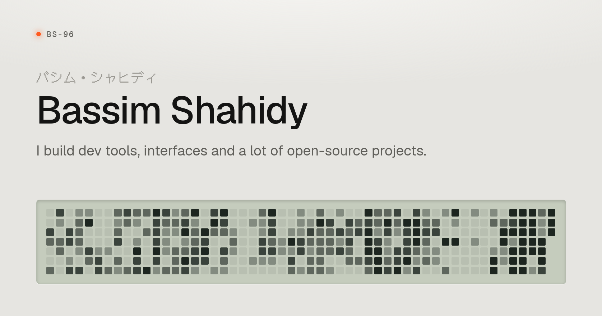

<a href="https://bassim.im">
  <picture>
    <source media="(prefers-color-scheme: dark)" srcset=".github/portfolio-black.png">
    
  </picture>
</a>

[**bassim.im**](https://bassim.im)

My personal site: projects, writing and a year of GitHub activity. Inspired by Japanese electronics from the 1990s, with black and silver finishes, lit contribution displays and a link card that moves between profiles.

Built with Astro 7, TypeScript and CSS, with no UI framework. The home page fetches GitHub activity, npm versions and download counts when it renders, and Vercel caches it for an hour (ISR); every other page is static.

## Run locally

Use [Bun](https://bun.sh) and Node.js 22.22 or newer.

```sh
bun install --frozen-lockfile
bun dev
```

The home page needs a `GITHUB_TOKEN` that can read public repositories: `vercel env pull .env.local`, or a fine-grained token of your own.

`bun run check` runs Astro's type checks, Oxlint and the formatter. `bun run build` produces Vercel's build output.

## What's where

| Path                    | Content                                                          |
| ----------------------- | ---------------------------------------------------------------- |
| `src/data/projects.ts`  | Projects, their order and links                                  |
| `src/lib/data.ts`       | Live GitHub activity, stars and npm stats for the home page      |
| `src/content/posts/`    | Markdown posts and YAML links to writing elsewhere               |
| `src/components/`       | Activity displays, project rows and the profile card             |
| `src/styles/global.css` | Shared styles and both finishes                                  |
| `og/`                   | Source artwork for the share card, README headers and touch icon |

The README headers are rendered from `og/og.html` in both finishes. The share card uses the same styles and contribution calendar as the site.

## Deploy

`bun run deploy` runs `scripts/deploy.sh`: it deploys a clean copy of `origin/main` to the Vercel project `portfolio`, where Vercel builds it, then loads the home page once to fill the cache.

The production address is **https://bassim.im**. Canonical links, Open Graph URLs and the sitemap use Vercel's `VERCEL_PROJECT_PRODUCTION_URL`, with `bassim.im` as the local fallback.

## License

The code is MIT. The posts in `src/content/posts/` are mine; ask before republishing them.
